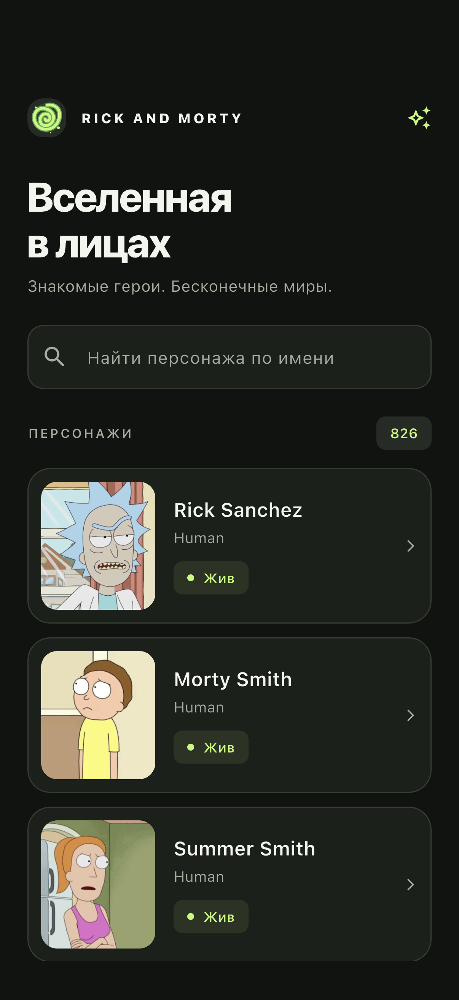
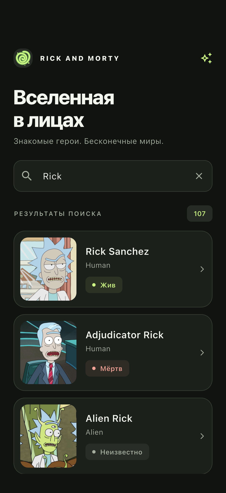
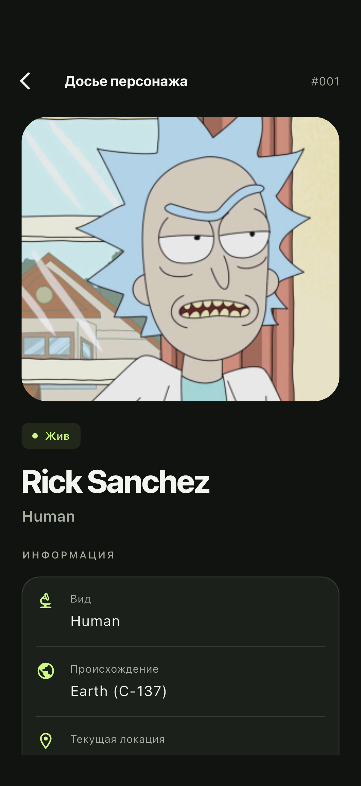

# Rick and Morty · Вселенная в лицах

Небольшое приложение на Flutter для просмотра персонажей Rick and Morty. Два экрана, поиск по имени и бесконечная прокрутка. Интерфейс на русском, имена и названия из API — в оригинале.

## Скриншоты

Снимки работающего приложения на iOS Simulator с данными настоящего API.

| Каталог | Поиск | Досье персонажа |
| --- | --- | --- |
|  |  |  |

Также: [сплеш загрузки](docs/screenshots/splash.png) · [экран пустой выдачи](docs/screenshots/empty.png).

## Возможности

- Нативная заставка и сплеш с зелёным порталом до завершения первой загрузки; при ошибке открывается каталог с повтором.
- Карточки с портретом, именем, видом и статусом. Статус обозначается текстом и цветом.
- Подгрузка следующих страниц при приближении к концу списка.
- Кнопка «Наверх» появляется после прокрутки на два экрана и плавно возвращает к началу каталога.
- Серверный поиск по имени с debounce 350 мс; очистка возвращает полный каталог.
- Досье с изображением, статусом, видом, происхождением и текущей локацией.
- Возврат из досье сохраняет поиск, загруженные страницы и позицию прокрутки.
- Отдельные состояния загрузки, пустой выдачи и ошибки с повтором. При сбое следующей страницы карточки остаются на экране.
- Заглушки для недоступных изображений, поддержка небольших экранов и увеличенного шрифта.

Данные: [Rick and Morty REST API](https://rickandmortyapi.com/documentation), `GET /api/character?page=…&name=…`. Ключи и переменные окружения не требуются. Для работы нужен интернет.

## Запуск

Проверенное окружение: Flutter **3.47.7 stable**, Dart **3.13.5**. Проект требует Dart `^3.13.5`. Для Android нужен Android SDK; для iOS — macOS, Xcode и установленный runtime симулятора. Пути к SDK настраиваются локально и в репозиторий не входят.

```bash
flutter pub get
flutter devices
flutter run -d <device-id>
```

Целевые платформы — Android и iOS. На физическом iPhone потребуется настроить подпись в Xcode; для симулятора подпись не нужна. Каталоги остальных платформ оставлены от исходного Flutter-шаблона, их поддержка не проверялась.

## Архитектура

```text
lib/
  app/                         приложение, bootstrap, DI и первый запуск
  core/
    logging/                   единый логгер и HTTP-interceptor
    network/                   HTTP-клиент и отмена запросов
  shared/
    branding/                  общий знак портала и шапка
    controllers/               пагинация и прокрутка наверх
    theme/                     цвета, типографика, отступы и размеры
    widgets/                   поверхности, поиск, сообщения, загрузка
  features/characters/
    domain/                    модели и контракт репозитория
    data/                      REST API, JSON-маппинг, реализация репозитория
    presentation/
      bloc/                    события и неизменяемые состояния
      formatters/              подписи статусов и представление значений
      screens/                 сборка каталога и деталей
      widgets/
        catalog/               заголовок, выдача и список
        character/             карточка, портрет и статус
        details/               заголовок досье и характеристики
```

Поток данных: **UI → событие → BLoC → контракт репозитория → REST-реализация**. Результат возвращается в UI через неизменяемое состояние. Модели домена содержат данные персонажей; преобразование JSON и HTTP-ошибок выполняет слой `data`.

`AppDependencies` связывает Dio, API-клиент и репозиторий через `MultiRepositoryProvider`. Приложение получает репозиторий из `context.read`, а представление подписывается на BLoC через `BlocBuilder` и `BlocSelector`. Статичная часть заголовка не подписывается на изменения выдачи; счётчик выбирает только запрос и число результатов. В тестах достаточно подменить `CharactersRepository` через внешний провайдер. HTTP-клиент закрывается вместе со scope зависимостей.

Общие элементы находятся в `shared`: `AppScaffold`, `AppSurface`, `AppSearchField`, `AppMessage`, `AppLoadingIndicator`, бейджи, строки характеристик и футер пагинации. Карточка и детали используют общий `CharacterPortrait`. Цвета, отступы, радиусы и длительности вынесены в токены темы. Обработка прокрутки и видимость кнопки «Наверх» принадлежат `PaginatedScrollController`; экраны управляют вводом и связывают компоненты с событиями.

Импорты из `lib/` используют `package:rick_and_morty/...`. Для общих UI-элементов, домена, данных и BLoC есть отдельные export-файлы; внутренние файлы модулей используют прямые импорты. Правила анализатора проверяют стиль и порядок импортов.

BLoC обрабатывает `CharactersOpened`, `CharactersSearchChanged`, `CharactersNextPageRequested`, `CharactersRetryRequested`. Внутреннее событие `CharactersSearchSubmitted` запускает поиск после debounce 350 мс; очистка выполняется без задержки.

Состояния: `CharactersInitial`, `CharactersLoading`, `CharactersLoaded`, `CharactersEmpty`, `CharactersError`. Состояние данных хранит список, следующую страницу, общее число результатов, признак дозагрузки и её ошибку. Равенство реализовано через Equatable, коллекции защищены от изменения.

BLoC отменяет устаревшие операции через независимый `RequestCancellation`; REST-репозиторий преобразует сигнал в отмену Dio. Номер поколения поиска дополнительно защищает от запоздавших ответов. Повторные запросы одной страницы исключаются состоянием загрузки, результаты объединяются по `id`. Следующая страница запрашивается за 500 пикселей до конца списка, конец определяется по `info.next`. После ошибки нужен явный повтор; `404` списка означает отсутствие результатов. Тайм-ауты соединения и ответа — по 15 секунд, для `429` показывается предложение повторить позже.

Стандартный `Navigator` сохраняет каталог, BLoC и контроллеры под экраном деталей. Все поля досье уже доступны из списка. Состояние сохраняется в текущей сессии; после закрытия приложения каталог загружается заново. Офлайн-база, избранное, дополнительные фильтры и публикация в магазинах не входят в реализацию.

## Ошибки и логирование

`main` запускает инициализацию Flutter и `runApp` внутри одной `runZonedGuarded`. Необработанные ошибки зоны, `FlutterError.onError` и `PlatformDispatcher.onError` направляются в общий `AppLogger` с исключением и stack trace. Обработчики находятся в `app/bootstrap/`.

Один экземпляр `AppLogger` на основе пакета `logger` доступен через `context.read<AppLogger>()`. В debug выводятся сообщения от уровня debug, в profile/release — warning и error. ProductionFilter сохраняет журнал ошибок и в release. Вывод идёт в консоль IDE и системные логи устройства.

`AppBlocObserver` пишет тип события и переход между типами состояний, а также ошибки BLoC. HTTP-interceptor отмечает запросы и ответы, сетевые ошибки и ошибки сервера. Отмена запроса и `404` списка обрабатываются штатно. Тела запросов, заголовки и содержимое списков в журнал не выводятся.

## Проверки

```bash
flutter analyze
flutter test
flutter build apk --debug
flutter build ios --simulator --debug
```

В `test/` находятся только ключевые проверки с подменённым API:

- разбор данных и пагинации, параметры поиска, `404`, сетевые ошибки и некорректный ответ;
- передача отмены из контракта репозитория в HTTP-запрос;
- перехват синхронных и асинхронных ошибок зоны, обработчики Flutter/platform и фильтрация уровней логирования;
- переходы состояний BLoC, дозагрузка без дублей, последняя страница и повтор после ошибок;
- debounce, отмена запросов, защита от устаревших ответов и сброс поиска;
- возврат из деталей с сохранением поиска и прокрутки без новых запросов;
- выход со сплеша при ошибке, повтор загрузки и отсутствие повторного сплеша во время поиска;
- вёрстка каталога и деталей на экране 320 × 568 с масштабом текста 200%.

Отдельный сценарий в `integration_test/` проверяет настоящее API на устройстве: каталог, поиск, детали, возврат, следующую страницу, кнопку «Наверх» и пустую выдачу. Он зависит от доступности сети и сервера и не запускается обычной командой `flutter test`.

Для повторной проверки и обновления скриншотов на iOS Simulator:

```bash
flutter drive \
  --driver=test_driver/integration_test.dart \
  --target=integration_test/app_test.dart \
  -d <ios-simulator-id>
```

Драйвер сохраняет PNG в `docs/screenshots/`. Скриншоты не являются golden-тестами и не сравниваются попиксельно.

## Иконка и заставка

Общий векторный знак портала рисуется в `lib/shared/branding/portal_mark.dart`. Он используется в шапке каталога и во Flutter-сплеше. Из него также получены иконки Android/iOS и изображения нативной заставки. Исходная PNG-иконка: `assets/branding/app_icon.png`.

Android содержит обычные и адаптивные иконки, отдельные настройки заставки для Android 12+. На iOS обновлены AppIcon и LaunchScreen. Цвет фона одинаковый у нативной заставки и приложения. Иконка закреплена в центре экрана и сохраняет размер при переходе от нативной заставки к Flutter; текст и индикатор плавно появляются под ней. Сплеш не задерживает открытие каталога искусственным таймером и не возвращается при поиске или повторе загрузки.

После изменения знака платформенные изображения можно пересоздать:

```bash
flutter test tool/generate_brand_assets.dart
```
